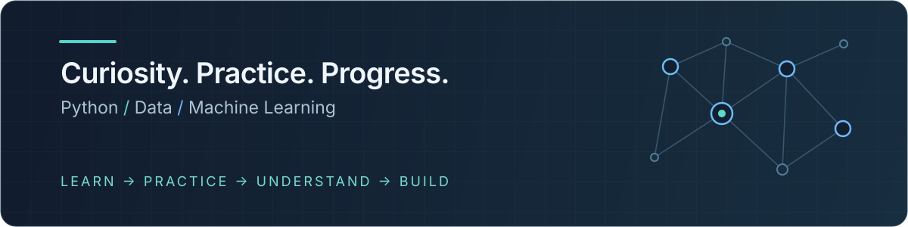

<div align="center">

# learning-python

**From Python Fundamentals to Machine Learning**



<p>
  
  
  
  
  
</p>

[Прогресс](#learning-progress) · [Структура](#repository-structure) · [Источники](#learning-resources) · [План](#learning-roadmap)

</div>

## About This Repository

Я студент второго курса прикладной математики и информатики МАИ. Веду этот репозиторий, чтобы системно готовиться к **ML / Data Science стажировке весной 2027 года**.

Здесь собираю учебные конспекты, примеры кода и самостоятельные задачи по Python и библиотекам для анализа данных. После изучения темы закрепляю её практикой: проверяю предположения, разбираю ошибки и возвращаюсь к тому, что осталось непонятным.

## Learning Progress

| Направление | Статус | Что есть в репозитории |
| :--- | :--- | :--- |
| **Python Fundamentals** | Закрепляю в практике | Python-код в упражнениях NumPy и Pandas; отдельного курса основ здесь нет |
| **NumPy** | Курс пройден | [13 конспектов](01-numpy/notes/) и [2 файла практики](01-numpy/practice/): массивы, индексация, агрегации, линейная алгебра, broadcasting |
| **Pandas** | Изучаю · урок 11 из 19 | [8 конспектов](02-pandas/notes/) и [6 файлов практики](02-pandas/practice/): Series / DataFrame, CSV, индексы, фильтрация, пропуски, `drop` и `astype` |
| **Matplotlib / Seaborn** | В планах | `03-matplotlib/` — заготовка; учебных материалов пока нет |
| **SQL** | В планах | Есть краткий пример SQLite в конспекте Pandas; отдельной практики SQL пока нет |
| **Scikit-learn** | В планах | `04-sklearn/` — заготовка; учебных материалов пока нет |
| **Machine Learning Projects** | В планах | ML-проекты пока не добавлены |

## Repository Structure

```text
learning-python/
├── 01-numpy/
│   ├── notes/                 # 13 конспектов
│   ├── practice/              # tasks_intro.py, tasks_02.py
│   └── learn_numpy.py         # рабочий файл экспериментов
├── 02-pandas/
│   ├── notes/                 # уроки 01–05, 09–11
│   ├── practice/              # задания 02, 03, 04_05, 09–11
│   └── learn_pandas.py        # примеры и эксперименты
├── 03-matplotlib/             # пока только .gitkeep
├── 04-sklearn/                # пока только .gitkeep
├── assets/
│   └── learning-path.svg      # оформление README
├── .gitignore
└── README.md
```

`notes/` — конспекты с объяснениями и примерами; `practice/` — условия задач и мои решения. Файлы `learn_*.py` служат рабочими черновиками. Дерево показывает основные материалы; локальные данные и результаты экспериментов опущены. Отдельной директории для будущих ML-проектов пока нет — она появится вместе с первым проектом.

## Установка и запуск

Из корня репозитория (macOS / Linux):

```bash
python3 -m venv .venv
source .venv/bin/activate
python -m pip install numpy pandas

python 01-numpy/practice/tasks_intro.py
python 02-pandas/practice/tasks_11.py
```

Для практики Pandas с CSV запускайте файл из директории `02-pandas/`, где находится `students.csv`:

```bash
cd 02-pandas
python practice/tasks_03.py
cd ..
```

## Learning Resources

| Направление | Источник и материалы |
| :--- | :--- |
| **Pandas** | Курс **Сергея Дубинина на YouTube**, 19 уроков. Точную ссылку на плейлист предстоит добавить. Текущая тема — [урок 11: `drop` и `astype`](02-pandas/notes/11-drop-astype.md), [практика](02-pandas/practice/tasks_11.py). |
| **NumPy** | В репозитории сохранены [конспекты уроков 1–13](01-numpy/notes/). Название курса, автор и точная ссылка в существующих файлах не указаны — источник предстоит добавить. |

**Нумерация Pandas соответствует оригинальному курсу.** Номера Markdown-файлов и практических заданий привязаны к номерам уроков; `tasks_04_05.py` объединяет практику двух уроков. Некоторые темы прохожу обзорно, поэтому отдельных файлов для уроков 06, 07, 08 и других может не быть. Пропуски намеренные, нумерация сохраняется.

## Learning Roadmap

**Ориентир — ML / Data Science стажировка · весна 2027**

- [ ] **Python fundamentals** — продолжать закреплять основы в задачах
- [x] **NumPy** — курс пройден; конспекты и практика сохранены
- [ ] **Pandas** — продолжить курс после урока 11 из 19
- [ ] **Matplotlib / Seaborn** — визуализация и исследование данных
- [ ] **SQL** — выборки, объединения, агрегации и оконные функции
- [ ] **Scikit-learn** — обработка признаков, обучение и оценка моделей
- [ ] **ML fundamentals** — валидация, метрики, переобучение и утечки данных
- [ ] **End-to-end ML projects** — от постановки задачи и данных до воспроизводимого результата
- [ ] **Internship preparation** — оформить проекты и подготовиться к техническим собеседованиям

## Practice Philosophy

> **Learn → Practice → Understand → Build**

Изучаю материал → решаю самостоятельные задачи → разбираю ошибки → применяю знания в проектах.

Стараюсь уметь объяснить, почему решение работает, предсказать результат до запуска и проверить своё понимание на новом примере. Следующий шаг — объединить отдельные навыки в законченные ML-проекты.
